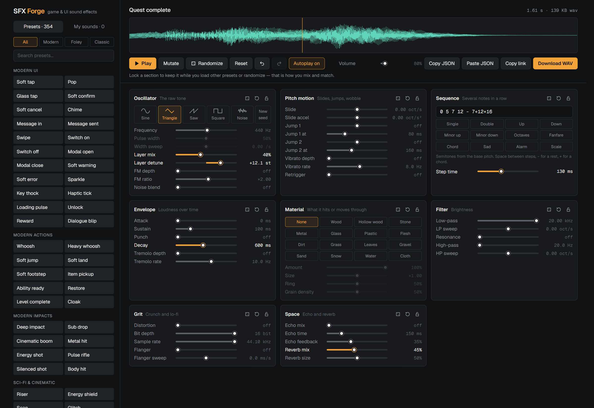
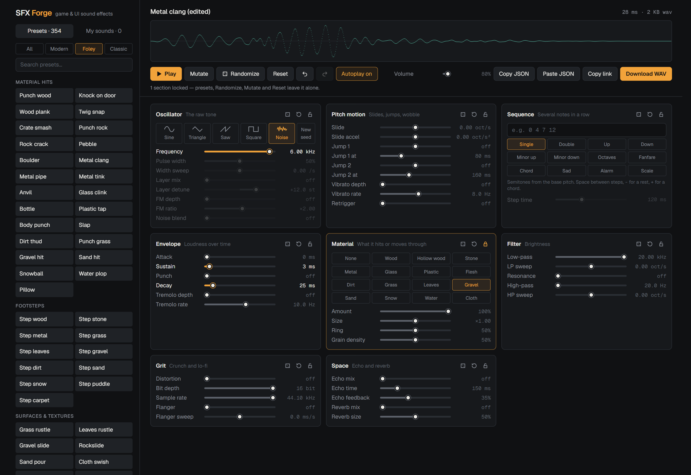
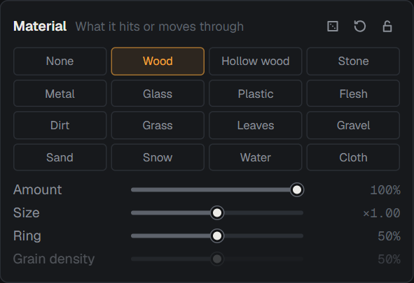
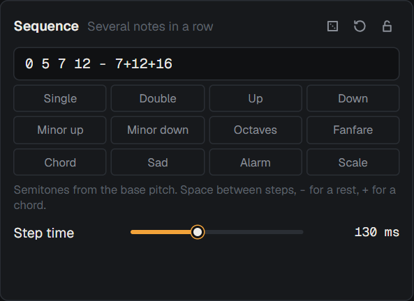

<h1 align="center">SFX <em>Forge</em></h1>

<p align="center">
  <strong>Design sound effects for games and interfaces, right in the browser.</strong><br>
  354 presets · 40+ sliders · 15 physical materials · a note sequencer · WAV export
</p>

<p align="center">
  
</p>

Every sound is synthesized from scratch on your machine. There are no samples, no audio libraries and no server: pick a preset, drag sliders until it sounds right, and download a WAV.

## Features

- **354 presets in 26 groups**, filterable by style:
  - **Modern** — soft UI taps and chimes, whooshes, impacts, elemental magic, status effects, inventory, puzzle sounds, stingers.
  - **Foley** — hits, footsteps and textures on real materials, creatures, vehicles, doors and mechanisms, weather.
  - **Classic** — chip-tune pickups, lasers, explosions, jumps and 8-bit jingles.
- **Mix and match** — lock any section, then load another preset or hit Randomize. Locked sections stay put, so you can keep the envelope of an explosion and try it with the pitch of a laser.
- **Mutate and Randomize** — nudge the current sound for near-variants, or roll a new one. Every section also has its own dice and reset buttons.
- **Materials** — run any sound through wood, stone, metal, glass, grass, gravel, water and more.
- **Sequencer** — turn one sound into a jingle with a short text score such as `0 4 7 12`.
- **Export and share** — 16-bit WAV, copy/paste as JSON, or a link that reopens the exact sound.
- **My sounds** — a named collection saved in your browser.
- **Undo/redo and autoplay**, with keyboard shortcuts for the things you do most.
- **Music** — a second tab that composes whole background tracks in twenty styles, from 15 seconds to 3 minutes, as seamless loops or one-off pieces.

## Mix and match with locks

<p align="center">
  
</p>

Above, the Material section is locked on **Gravel** and the *Metal clang* preset was loaded on top of it: the hit comes from one preset, the surface from another. The title gains "(edited)" whenever the sound no longer matches a preset exactly.

## Materials and sequences

<table>
<tr>
<td width="50%" valign="top">



**Material** decides what the sound hits or moves through.

- **Solid** materials ring when struck: Wood, Hollow wood, Stone, Metal, Glass, Plastic, Flesh.
- **Loose** materials break the sound into tiny grains: Grass, Leaves, Gravel, Sand, Snow, Water, Cloth.
- **Dirt** does both.

**Size** makes the object bigger and lower, **Ring** sets how long solids resonate, and **Grain density** goes from sparse crackle to dense hiss.

</td>
<td width="50%" valign="top">



**Sequence** plays the sound as several notes. Write semitones relative to the Frequency slider:

| Score | Meaning |
|---|---|
| `0 4 7 12` | four notes up a major chord |
| `0 - 0` | note, rest, note |
| `0 7+12+16` | a note, then a three-note chord |

**Step time** is the gap between notes. Notes longer than a step overlap.

</td>
</tr>
</table>

## Music

The **Music** tab writes a new piece every time: pick a style and a length, and it chooses a key, a chord progression, a tune and an arrangement, then renders the result to a stereo WAV.

- **Styles** — Upbeat, Cozy, Chill, Action, Adventure, Mysterious, Boss fight, Retro, Dreamy, Sad, Epic, Funky, Jazzy, Tropical, Sci-fi, Stealth, Spooky, Victory, Racing and Lullaby. Each has its own tempo range, scales, instruments and drum kit.
- **Blends** — select up to three styles and each takes charge of part of the band: one brings the rhythm, one the harmony, one the melody. Tempo and busyness meet in the middle.
- **Length** — 15 s, 30 s, 1, 2 or 3 minutes. The tempo is nudged so whole bars fill the length exactly.
- **Seamless loop** — the track ends where it starts and the reverb tail is folded back into the first bars, so it repeats without a gap. Turn it off for a piece with an intro and an ending.
- **Layers** — drop the melody, chords, arpeggio, bass or drums to get a thinner mix, or stems of the same track.
- **Arrangement** — reorder the sections by dragging, change what each one is (intro, theme A, theme B, break, outro), make it longer or shorter two bars at a time, set how full it sounds, and add or remove sections. The themes stay the same tunes wherever you put them.
- **Recent tracks** — every track is remembered by its settings and seed, and comes back identical.

Tracks avoid sounding like one bar on repeat because they are built in sections (two themes and a quieter break). A theme is a two-bar motif that is stated, answered, contrasted and resolved; each time a section returns it keeps the motif but gets new answering phrases, a different set of instruments and its own drum variations and fills.

## Getting started

Requires Node.js 20.9 or newer.

```bash
npm install
npm run dev
```

Then open <http://localhost:3000>.

| Command | What it does |
|---|---|
| `npm run dev` | Start the development server |
| `npm run build` | Build the static site into `out/` |
| `npm run lint` | Run ESLint |

## Keyboard shortcuts

| Key | Action |
|---|---|
| <kbd>Space</kbd> | Play (in Music: play or stop) |
| <kbd>G</kbd> | Music: generate another track |
| <kbd>R</kbd> | Randomize |
| <kbd>M</kbd> | Mutate |
| <kbd>Ctrl</kbd>+<kbd>Z</kbd> | Undo |
| <kbd>Ctrl</kbd>+<kbd>Shift</kbd>+<kbd>Z</kbd> or <kbd>Ctrl</kbd>+<kbd>Y</kbd> | Redo |

Double-click a slider's name to reset it.

## How a sound is built

Each sound is rendered offline to a 44.1 kHz buffer, then played through Web Audio or encoded as WAV.

```
Oscillator ─► Pitch motion ─► Envelope ─► Sequence ─► Material ─► Filter ─► Grit ─► Space ─► Normalize
 sine, tri,    slide, jumps,   attack,     repeat as    resonant    low/high   drive,    echo,    to the
 saw, square,  vibrato,        sustain,    notes and    modes and   pass with  bitcrush, reverb   Volume
 noise, FM,    retrigger       punch,      chords       grains      sweeps     flanger            slider
 2nd layer                     decay
```

Output is normalized to the Volume slider, so every export peaks at the same level and never clips. Rendering is deterministic: the same parameters always give the same audio, including the noise.

## Project structure

```
src/
├─ app/                    Next.js app router shell (layout, page, global styles)
├─ components/
│  ├─ App.tsx              Switches between the two studios
│  ├─ Studio.tsx           Sound effects: library, transport, sections
│  ├─ MusicStudio.tsx      Music: style and length options, transport, track details
│  ├─ ParamSlider.tsx      One labelled slider
│  └─ Waveform.tsx         Canvas waveform with playhead
├─ lib/music/
│  ├─ styles.ts            The twenty styles, plus scales and chord progressions
│  ├─ compose.ts           Writes a piece as timed notes: form, chords, melody, parts
│  ├─ patches.ts           Instrument definitions
│  ├─ render.ts            Plays a score: instruments, drums, echo, reverb, master
│  └─ worker.ts            Runs compose + render off the main thread
└─ lib/sfx/
   ├─ synth.ts             The synthesis engine and WAV encoder
   ├─ params.ts            Every slider: range, curve, default, randomizer rules
   ├─ materials.ts         Material definitions (modes and grains)
   ├─ melody.ts            Sequence parser and built-in patterns
   ├─ presets.ts           Core presets
   ├─ presets-more.ts      Creatures, machines, magic, stingers and the rest
   └─ exciters.ts          Shared "tap" and "punch" starting points for foley presets
```

### Adding a preset

A preset is one line: a name and only the values that differ from the defaults. Add it to a group in `presets.ts` or `presets-more.ts`:

```ts
"Punch wood": { ...FIST, material: "wood" },
Coin: { wave: "square", frequency: 988, jump1: 5, jump1Time: 0.07, sustain: 0.08, punch: 0.4, decay: 0.35 },
```

The quickest way to write one is to design the sound in the app, press **Copy JSON**, and paste the result.

### Adding a material

Add an entry to `MATERIALS` in `materials.ts`. Solid materials list resonant modes as `[frequency Hz, gain, ring-out seconds]`; loose materials describe their grains. It appears in the Material section automatically.

## Deploying to GitHub Pages

The app builds to plain static files, and `.github/workflows/deploy.yml` publishes them on every push to `main`.

1. Push the repository to GitHub.
2. In **Settings → Pages**, set **Source** to **GitHub Actions**.

The site is then served at `https://<user>.github.io/<repo>/`. The workflow passes the repository name to the build as the base path, so no configuration is needed.

## Built with

[Next.js](https://nextjs.org) 16 · [React](https://react.dev) 19 · [TypeScript](https://www.typescriptlang.org) · [Tailwind CSS](https://tailwindcss.com) 4 · Web Audio API
